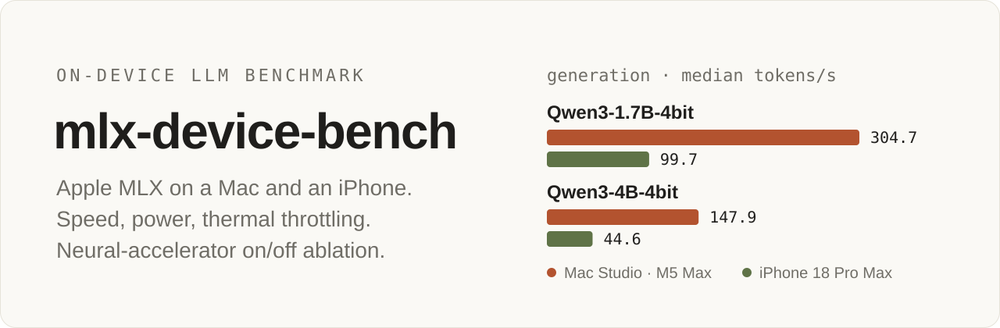
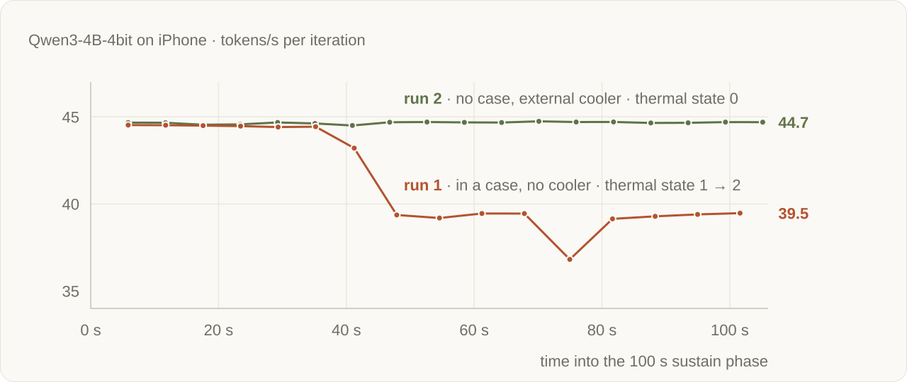
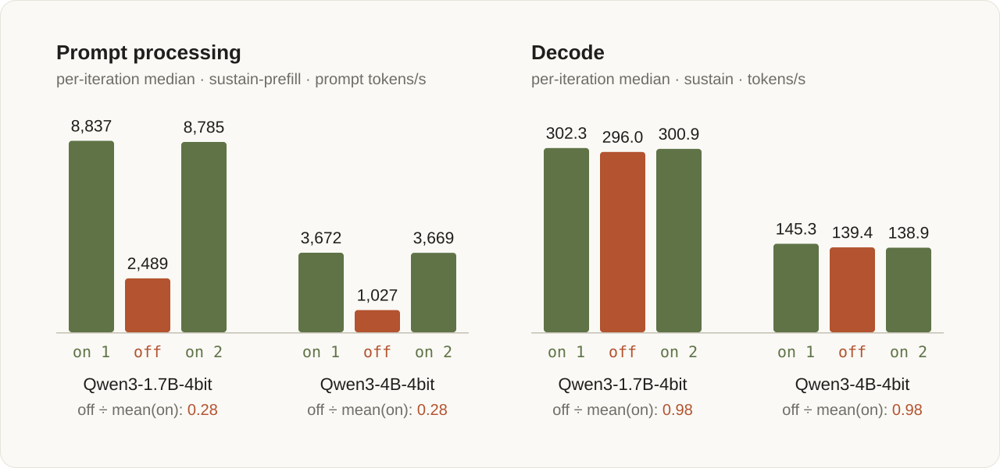

<div align="center">

<picture>
  <source media="(prefers-color-scheme: dark)" srcset="assets/hero-dark.svg">
  
</picture>

<br>

[](LICENSE)


[English](README.md) · **简体中文**

**同一套 Apple MLX 负载跑在 Mac 和 iPhone 上：速度、功耗、发热降频，外加神经加速器开关的消融实验。**

</div>

这个仓库给 Apple [mlx-swift-examples](https://github.com/ml-explore/mlx-swift-examples) 里的 LLMEval 示例 app 加了一个无界面的基准测试模式，用同一套固定的贪心解码负载在 Mac Studio（M5 Max）和 iPhone 18 Pro Max 上运行，同时记录功耗。

用 Qwen3-1.7B-4bit 和 Qwen3-4B-4bit 两个模型测：

- **速度。** Mac 的生成速度是手机的 3.1–3.3 倍，处理 10,073 token 长提示的速度是手机的 4.4–4.6 倍。
- **输出一致。** 两台设备输出的哈希完全一致。
- **手机功耗。** 手机连续生成 100 秒时整机功耗为 11.0–11.9 W。
- **Mac 上的 NAX 消融。** 关掉 MLX 的神经加速器矩阵乘路径（NAX）后，提示处理只剩正常速度的 0.28–0.31 倍（取决于用哪个指标）。持续生成时按每次迭代中位数算的解码速度只差约 2 %（短测中位数波动更大，4B 最多差 -9 %）。

**数字从哪来。** 表格里的所有数字都是用 `python3 bench/summarize.py <log> [power.jsonl]` 从 [`results/`](results) 里的文件算出来的（每次测试的输出在 [`results/summaries/`](results/summaries)）。比值、乘积和每 token 能耗是在这些输出上做的算术；第 2 节的"安静空闲基线"按那里的说明直接从 Mac 功耗文件计算。

**不在本仓库里的。** 有些说法依据的是工作中的记录，这些记录不在本仓库里：NAX 开关是怎么验证的（构建命令、二进制符号、调用栈采样）、Mac 最终那次测试前后的进程检查，以及手机的测试条件（手机壳、散热器、亮度）。

## 宣传片

一分钟的短片，讲的是这里的测量结果，以及 [Pocket LLM](https://github.com/Justaboringname/pocket-llm)——一个用这些数据选默认模型的 iPhone 聊天 app。片中的手机画面和 Mac 上的基准窗口都是录屏，大字用的是下面表格里的中位数。Mac 窗口是后来另跑的一次较短的同款基准，所以它日志里是 296–297 tok/s，而表格里是 304.7。

https://github.com/user-attachments/assets/d8ab1fb9-eb3f-4aab-80b2-2472c0d2402f

## 1. Mac 对比 iPhone

每项取一次预热之后 3 次正式运行的中位数。"gen" 是 48 token 的提示后生成 256 个 token；"prefill" 是 10,073 token 的提示后生成 16 个 token。TTFT 指从开始生成到拿到第一段文本的墙钟时间。峰值内存是 MLX 分配器在该模型加载和全部运行期间的峰值，不是整个进程的内存。

| | Mac Studio（M5 Max） | iPhone 第 1 次测试 | iPhone 第 2 次测试（加散热） |
|---|---|---|---|
| **Qwen3-1.7B-4bit** 生成，token/s | 304.7 | 99.7 | 99.8 |
| 预填充，提示 token/s | 8,757 | 2,008 | 2,010 |
| 10,073 token 提示的 TTFT，秒 | 1.15 | 5.02 | 5.01 |
| 峰值内存，GB | 2.94 | 2.65 | 2.65 |
| **Qwen3-4B-4bit** 生成，token/s | 147.9 | 44.6 | 44.7 |
| 预填充，提示 token/s | 3,720 | 801 | 816 |
| 10,073 token 提示的 TTFT，秒 | 2.71 | 12.58 | 12.34 |
| 峰值内存，GB | 4.42 | 4.27 | 4.27 |

生成用的是温度 0（贪心）。每种构建在每次运行里都给出同样的文本，两台设备的输出哈希（生成文本的 64 位 FNV-1a）也完全一致：1.7B gen `799ec6e941b85604`，1.7B prefill `0d02202ec08edfed`，4B gen `c563528899d11540`，4B prefill `49d1a6036bfc4348`。Mac 这一列来自单独一次测试（见注意事项）。

**设备。**

| | Mac Studio（M5 Max） | iPhone 18 Pro Max |
|---|---|---|
| 型号标识 | `Mac17,14` | `iPhone19,3` / `V64AP` |
| 芯片 / GPU | Apple M5 Max，GPU `applegpu_g17s` | GPU `applegpu_g19p` |
| 系统 | macOS 27.2.1 (Build 26B131) | iOS 27.2.1 (Build 24B156) |

## 2. 持续负载与功耗

短测之后，每个模型会把同一个 256 token 的回答连续不断地生成 100 秒（"sustain"）。Mac 上接着再连续重复 60 秒的 10,073 token 预填充（"sustain-prefill"）。"整体" token/s 等于该阶段产出的 token 数除以阶段时长，所以每次迭代的提示处理时间也算在里面。J/token 等于阶段平均功率除以整体 token/s；"毛值"用实测功率，"净值"减去了同一次测试开头测得的空闲基线。

**两台设备的功耗口径不同，瓦数不能直接对比。** iPhone 是整机功耗：`SystemLoad`，这是 AppleSmartBattery 里一个没有文档的字段，我们把它理解为手机消耗的总功率（SoC、内存、屏幕和无线模块）。Mac 给的是只算 GPU 的功耗，不含 DRAM（1.7B 和 4B 模型持续解码时 DRAM 分别为 7.6 W 和 8.6 W），同时附上 Mac 整机功耗（"整机" = SMC 整机功耗减去 USB 口对外输出）。这台 Mac 是 Mac Studio，所以"整机"也不包括有独立电源的外接显示器。

### iPhone（整机）

| | 第 1 次测试 | 第 2 次测试（加散热） |
|---|---|---|
| 空闲基线，W | 1.91 | 0.65 |
| **1.7B** 持续生成功率，W | 11.86 | 11.29 |
| 整体 token/s | 96.6 | 97.2 |
| 首次迭代 → 末次迭代，token/s | 99.2 → 99.1（-0.1 %） | 99.2 → 99.4（0.2 %） |
| 热状态 开始 → 结束（最高） | 0→0（0） | 0→0（0） |
| J/token，毛值 / 净值 | 0.123 / 0.103 | 0.116 / 0.109 |
| **4B** 持续生成功率，W | 11.03 | 11.68 |
| 整体 token/s | 40.3 | 43.8 |
| 首次迭代 → 末次迭代，token/s | 44.5 → 39.5（-11.4 %） | 44.7 → 44.7（0.1 %） |
| 热状态 开始 → 结束（最高） | 1→2（2） | 0→0（0） |
| J/token，毛值 / 净值 | 0.274 / 0.226 | 0.267 / 0.252 |

热状态取自 iOS 的 `ProcessInfo.thermalState`（0 正常，1 一般，2 严重，3 危急）。两次手机测试同时改了好几样东西：

| | 第 1 次测试 | 第 2 次测试 |
|---|---|---|
| 手机壳 | 带壳 | 取下 |
| 外部散热 | 无 | 单独供电的外置散热器 |
| 屏幕亮度 | 默认 | 手动调低 |
| 每个持续阶段之前和换模型之间的停顿 | 无 | 60 秒（`--bench-phase-cooldown=60`） |
| 空闲阶段，设定 / 实测 | 60 秒 / 60.1 秒 | 90 秒 / 95.9 秒 |
| app 构建 | 较早的 `Benchmark.swift` 构建（见注意事项） | 与发布的 `Benchmark.swift` 事件和选项相同 |

第 1 次测试里，4B 模型每次迭代的速度在 100 秒内从 44.5 降到 39.5 token/s（-11.4 %），热状态同时升到 2；第 2 次测试全程保持在热状态 0，速度不变。下图每个点是一次迭代，取自 [`results/`](results) 里两份手机日志的 `run` 事件。

<picture>
  <source media="(prefers-color-scheme: dark)" srcset="assets/thermal-dark.svg">
  
</picture>

两次手机都插着 USB 供电、没有在充电（电量 80 %），外部输入覆盖了 `SystemLoad` 的 97–100 %。

### Mac Studio，M5 Max（只算 GPU；同时给出 DRAM 和 Mac 整机功耗）

| | Qwen3-1.7B-4bit | Qwen3-4B-4bit |
|---|---|---|
| 持续生成整体 token/s | 295.8 | 144.8 |
| 首次迭代 → 末次迭代，token/s | 302.8 → 304.0 | 147.3 → 148.0 |
| GPU W / DRAM W / 整机 W | 28.1 / 7.6 / 80.8 | 31.6 / 8.6 / 79.8 |
| GPU J/token，毛值 / 净值 | 0.095 / 0.095 | 0.218 / 0.218 |
| 整机 J/token，毛值 / 净值（净值偏低 †） | 0.273 / 0.177 | 0.551 / 0.355 |
| 整机 J/token，按安静空闲基线算的净值 ‡ | 0.235 | 0.474 |
| 持续预填充整体 提示 token/s | 7,751 | 3,441 |
| 持续预填充 GPU W / DRAM W / 整机 W | 76.0 / 3.2 / 126.8 | 88.7 / 2.6 / 134.2 |
| 持续预填充 每个提示 token 的 mJ，GPU 毛值 / 净值 | 9.81 / 9.81 | 25.76 / 25.76 |
| 持续预填充 每个提示 token 的 mJ，整机毛值 / 净值（净值偏低 †） | 16.36 / 12.69 | 39.00 / 30.73 |
| 持续预填充 每个提示 token 的 mJ，按安静空闲基线算的整机净值 ‡ | 14.92 | 35.75 |

同一次测试的空闲基线（24 个样本）：GPU 0.00 W，整机 28.5 W。

- † **整机净值偏低。** 空闲阶段前段有一个无关进程造成了 CPU 突发：CPU 功率 24–28 W，一直持续到阶段开始后约 16 秒。这会抬高整个阶段的整机基线，而别处都是用这种方法算基线的。
- ‡ **安静空闲基线。** 这一行改用空闲阶段里 CPU 功率低于 5 W 的 11 个样本的均值：11.2 W。这些样本都在阶段开始 18 秒以后，即突发结束之后。它是直接从 `results/mac-m5max.power.jsonl` 算的，不是由 summarize.py 算出。

GPU 基线不受影响。全程热状态为 0。手机两次测试都没有跑持续预填充阶段。

## 3. 消融：Mac 上 MLX 的神经加速器路径

MLX 可以把矩阵乘、量化矩阵乘和注意力交给用到 GPU 神经加速器的内核（MLX 源码里叫 "NAX"）。前提是 `backend/metal/device.h` 里的 `metal::is_nax_available()` 接受这块 GPU。编译 MLX 时定义 `MLX_METAL_NO_NAX`，这个函数就恒为 false，于是改走普通的 GPU 内核。

这个函数接受 Mac 的 GPU（`applegpu_g17s`）。按同样的判断，它也接受 iOS 27.2.1 (Build 24B156) 上 iPhone 的 GPU（`applegpu_g19p`），所以上面手机的数字应该也是开着 NAX 测的。这一点是从源码推断的，没有在手机上用符号或调用栈采样确认。

同样的测试（另加 30 秒空闲、100 秒持续生成和 60 秒持续预填充）在 Mac 上按 NAX 开、NAX 关、NAX 开的顺序各跑了一次。这三次测试用的是较早版本的补丁，那时还没有 `--bench-phase-cooldown`（这三次也用不到）。它们还多传了一个 `--bench-variant=nax-on` / `nax-off` 标签，参数解析会忽略它。

<picture>
  <source media="(prefers-color-scheme: dark)" srcset="assets/nax-dark.svg">
  
</picture>

| 模型 | 指标 | NAX 开（1） | NAX 关 | NAX 开（2） | 关 ÷ 开的均值 | 开(2) ÷ 开(1) |
|---|---|---|---|---|---|---|
| 1.7B | 生成中位数（短测，波动大），token/s | 297.4 | 295.2 | 272.1 | 1.04 | 0.91 |
| 1.7B | 预填充中位数（短测），提示 token/s | 8,705 | 2,529 | 8,647 | 0.29 | 0.99 |
| 1.7B | 持续预填充整体，提示 token/s | 7,741 | 2,386 | 7,706 | 0.31 | 1.00 |
| 1.7B | 持续预填充，每次迭代的中位数，提示 token/s | 8,837 | 2,489 | 8,785 | 0.28 | 0.99 |
| 1.7B | 持续预填充 GPU W | 78.5 | 65.0 | 79.6 | | |
| 1.7B | 持续预填充 GPU 每提示 token mJ（毛值） | 10.15 | 27.24 | 10.33 | | |
| 1.7B | 持续生成，每次迭代的中位数，token/s | 302.3 | 296.0 | 300.9 | 0.98 | 1.00 |
| 1.7B | 持续生成 GPU W | 28.7 | 30.2 | 29.4 | | |
| 1.7B | 持续生成 GPU J/token（毛值） | 0.097 | 0.108 | 0.100 | | |
| 4B | 生成中位数（短测，波动大），token/s | 144.1 | 131.9 | 145.0 | 0.91 | 1.01 |
| 4B | 预填充中位数（短测），提示 token/s | 3,659 | 1,005 | 3,646 | 0.28 | 1.00 |
| 4B | 持续预填充整体，提示 token/s | 3,355 | 1,004 | 3,369 | 0.30 | 1.00 |
| 4B | 持续预填充，每次迭代的中位数，提示 token/s | 3,672 | 1,027 | 3,669 | 0.28 | 1.00 |
| 4B | 持续预填充 GPU W | 89.5 | 67.6 | 87.5 | | |
| 4B | 持续预填充 GPU 每提示 token mJ（毛值） | 26.67 | 67.32 | 25.96 | | |
| 4B | 持续生成，每次迭代的中位数，token/s | 145.3 | 139.4 | 138.9 | 0.98 | 0.96 |
| 4B | 持续生成 GPU W | 29.0 | 33.2 | 29.9 | | |
| 4B | 持续生成 GPU J/token（毛值） | 0.207 | 0.249 | 0.221 | | |

数字能说明的：

- **提示处理。**
  - 关掉 NAX 后，按短测预填充中位数和持续预填充每次迭代的中位数算，提示处理速度是开着时的 0.28–0.29 倍。
  - 按持续预填充的整体速度算是 0.30–0.31 倍；整体速度里还包括每次迭代生成的 16 个 token 和固定开销。
  - 这几行里两次 NAX 开之间的差别在 0.7 % 以内。
  - 持续预填充时，NAX 关的 GPU 功率反而更低：65.0 W（1.7B）和 67.6 W（4B），NAX 开时分别是 78.5–79.6 W 和 87.5–89.5 W。所以每个提示 token 的 GPU 能耗是原来的 2.6–2.7 倍。
- **解码。**
  - 按每次迭代的中位数算，关掉 NAX 后的持续解码速度是开着时均值的 0.98 倍（1.7B，-1.9 %）和 0.98 倍（4B，-1.9 %）。
  - 两次 NAX 开之间的比值本身就是 1.00（1.7B）和 0.96（4B）。1.7B 的下降比两次 NAX 开之间的差别大，但 NAX 开只有一对测试，而且 4B 的两次 NAX 开之间就差了 4.4 %，所以这两个解码差异都算不上分辨出来了。
  - 短测的生成中位数波动更大：1.7B 的开(2) ÷ 开(1) 是 0.91；NAX 关的 4B 短测，生成的离散度为 10.7 %，预填充为 6.9 %。
  - 持续解码时，NAX 关的 GPU 功率是 30.2 W（1.7B）和 33.2 W（4B），NAX 开时分别是 28.7–29.4 W 和 29.0–29.9 W。
- **输出。** 关掉 NAX 后，256 token 的生成文本和开着时不同（1.7B `189c3a9519c9b492`，4B `cae902a5673ea4ef`），16 token 的预填充输出则完全一致。每种构建在自己的几次测试里都是确定的。

开关是否真的生效，用三种方式确认过（依据的是不在本仓库里的工作记录）：

- `backend/metal/matmul.cpp`、`quantized.cpp`、`scaled_dot_product_attention.cpp` 的 arm64 编译命令从一个响应文件读取宏定义。NAX 关的构建里，这个文件包含正常构建的全部定义，再加上 `-DMLX_METAL_NO_NAX=1`。
- 正常构建的 app 二进制里有 110 个和 NAX 相关的主机符号（例如 `qmm_nax`、`get_qmm_nax_kernel`、`get_steel_attention_nax_kernel`）以及 88 个 `_nax` 内核名字符串；NAX 关的二进制里一个都没有。
- 在用 Qwen3-0.6B-4bit 做的短冒烟测试中，持续预填充阶段的调用栈采样显示：正常构建走 `qmm_nax` 和 `get_steel_attention_nax_kernel`，NAX 关的构建走 `qmm` 和 `get_steel_attention_kernel`。这些采样来自冒烟测试，不是表中那三次测试。

**局限。**

- 这三次测试分辨不出几个百分点的解码差异。
- **干扰：**
  - 第一次 NAX 开的测试和 iPhone 第 1 次测试时间重叠，那次手机测试是同一台 Mac 通过 USB 驱动的。
  - 第二次 NAX 开的测试中，另一个程序短暂编译过代码，开始时还有一个无关进程占用了大量 CPU。
  - NAX 关的那次测试没有发现干扰，但它的短测波动最大。
- **USB 口输出：** 三次消融测试里都有约 16 W 的 USB 口输出（Mac 给其他设备供的电），空闲时分别是 16.3、15.7 和 15.7 W；Mac 最终那次测试只有 0.9 W。这部分不计入"整机"，也不影响 GPU 数字。

## 4. 一个观察（推断，不是测量）

把生成速度中位数乘以下载的模型文件大小，两个模型在同一台设备上得到的数很接近：这几次测试里，Mac 上相差 13 % 以内，iPhone 上相差 4 % 以内。

| | 模型文件，GB | Mac：生成速度 × 大小，GB/s | iPhone 第 1 次测试 | iPhone 第 2 次测试 |
|---|---|---|---|---|
| Qwen3-1.7B-4bit | 0.98 | 299 | 98 | 98 |
| Qwen3-4B-4bit | 2.28 | 337 | 102 | 102 |

文件大小取自下载模型时报告的快照大小（日志中记录的 `download_progress.totalUnitCount`），主要是 4-bit 权重。如果每生成一个 token 都要把全部权重从内存里读一遍，也就是说解码受限于内存带宽而不是算力，那么两个模型的这个乘积就应该很接近，和这里看到的一致。本测试没有直接测量内存带宽。

## 5. 方法

**负载。** 系统消息 "You are a helpful assistant"，聊天模板带 `enable_thinking: false`，`GenerateParameters(maxTokens: N, temperature: 0)`（贪心）：

- `gen`：用户提示 "Write a detailed story of at least 1000 words about a lighthouse keeper who finds a message in a bottle."（套模板后 48 token），`maxTokens` 256。
- `prefill`：LLMEval 自带的 `LongPrompt.md`（套模板后 10,073 token），`maxTokens` 16。

**每次测试的流程。**

1. 可选的空闲阶段（`--bench-idle`），此时还没有加载模型。
2. 对每个模型：
   - 按 LLMEval 原本的方式下载并加载；
   - 每种负载先预热一次，再跑 `--bench-runs` 次（3 次）正式运行，每次正式运行前冷却 10 秒；
   - 然后是可选的持续阶段（`--bench-sustain`、`--bench-sustain-prefill`），之前可以用 `--bench-phase-cooldown` 加停顿。

每个事件在 stdout 和 app 内的 `Documents/bench-results.jsonl` 里各写一行 `BENCH {json}`。

**字段**（`run` 事件）：

- `promptTokenCount`、`generationTokenCount`、`promptTime`、`generateTime`、`promptTokensPerSecond`、`tokensPerSecond`：直接取自 MLX 自己的 `GenerateCompletionInfo`。
- `ttftWallSeconds`：从调用 `generate`（它会完成整个提示的预填充）到第一段非空文本的墙钟时间。
- `peakMemoryBytes`：MLX 分配器峰值，每次运行前清零。
- `thermalStateBefore` / `thermalStateAfter`。
- `outputHash`：生成文本的 64 位 FNV-1a 哈希。
- `stopReason` / `stopReasonEffective`（见注意事项）。
- `elapsedInPhase`：只有持续阶段的运行才有。

其他事件：`device`、`model_load_start`、`download_progress`、`model_loaded`（含参数 dtype 和一次单 token 前向的 dtype）、`sustain_start/_end`、`sustain_prefill_start/_end`、`phase_cooldown_start/_end`、`idle_start/_end`、`model_done`、`error`、`done`。

**iPhone 功耗。**

- `bench/power-sample.py` 每 5 秒通过 USB 调一次 `idevicediagnostics ioregentry AppleSmartBattery`（[libimobiledevice](https://libimobiledevice.org)），只保留 `PowerTelemetryData` 里白名单内的字段。
- 注册表快照大约每 20 秒才刷新一次，但累加器（`AccumulatedSystemLoad`、`SystemLoadAccumulatorCount` 等）每秒累加一个样本。所以两次快照之间的平均功率等于 ΔAccumulatedSystemLoad ÷ ΔSystemLoadAccumulatorCount。
- 某个阶段的功率只用完全落在该阶段内的快照区间来算（阶段时间和快照时间都是手机自己的时钟）。所以功率窗口可能比阶段短（这里每个约 100 秒的持续阶段只覆盖了 80–91 秒），而 J/token 除的是整个阶段的速度。
- `SystemLoad` 和 `SystemPowerIn` 都是没有文档的字段。我们把 `SystemLoad` 理解为手机消耗的功率，把 `SystemPowerIn` 理解为从 USB 输入的功率。

**Mac 功耗。**

- `bench/mac-power-sample.py` 大约每秒调用一次 [`fanctl`](https://github.com/Justaboringname/fanctl) `status`。
- 每次调用给出约 1 秒窗口内的 CPU、GPU、ANE、DRAM 功率，以及 SMC 整机功率（PSTR）和 USB 口对外输出功率。
- 本文的"整机" = PSTR 减去 USB 口输出。
- 每个阶段的前 3 秒不计入；一个样本算不算在阶段里，看它约 1 秒窗口的中点是否落在阶段内。

**版本。**

| 组件 | 版本 |
|---|---|
| mlx-swift-examples | 提交 `ef1084d` |
| mlx-swift | 0.31.4（MLX core 0.31.1） |
| mlx-swift-lm | 3.31.3 |
| Xcode | 27.2（27B52） |
| macOS | 27.2.1 (Build 26B131) |
| iOS | 27.2.1 (Build 24B156) |
| Mac 构建配置 | Release |

运行时两个模型的参数张量只有两种 dtype：bfloat16，以及打包 4-bit 权重的 uint32；logits 为 bfloat16。没有设置任何 `MLX_*` 环境变量（MLX 默认开启 TF32）。除了 iPhone 第 1 次测试（它早于这些字段），每份日志都记录了这些信息。

## 6. 注意事项

- **每种手机条件只测了一次。** 两次 iPhone 测试同时改了好几样东西（见第 2 节的表）。第 1 次测试的空闲基线（1.91 W）多半还没稳定下来。第 2 次是 0.65 W，但它的空闲阶段比 90 秒的设定多跑了 5.9 秒，原因不明。净值也跟着带上了这份不确定性。
- **手机第 1 次测试用的是较早的构建。** 它用的 `Benchmark.swift` 构建比发布的版本早：
  - 没有持续预填充和阶段冷却这两个选项；
  - 没有记录 MLX 环境变量和参数 / logits 的 dtype；
  - 加载后也没有跑那次探测 dtype 的前向。

  负载相同，空闲阶段为 60 秒。两次手机测试都没有持续预填充阶段。
- **手机第 1 次测试和一次 Mac 测试重叠。** 它进行时，同一台 Mac 正在跑第一次 NAX 开的消融测试（同时通过 USB 驱动手机）。手机的数字是在手机上测得的，但没有检查这次重叠是否对它们有影响。
- **Mac 最终那次测试。** 它的数字在 `results/summaries/mac-m5max.md`；下面说的进程检查没有记录在仓库里。
  - 开始前要求连续两次检查都没有发现编译器、Xcode 构建、设备工具或其他占用超过 50 % CPU 的进程，测试期间每 30 秒做一次同样的检查。
  - 只有一次检查（在空闲阶段的最初几秒）发现了一个占用超过 50 % CPU 的无关进程，也就是第 2 节说的那次 CPU 突发。它影响整机净值，不影响 GPU 数字。
  - 测试中的其他检查都没有发现问题。
  - 当天更早的一次尝试干扰更多，已经弃用。
- **Mac 这一列来自单独一次测试。** 同一天在这台 Mac 上做的几次 NAX 开的消融测试都有干扰，它们的短测生成中位数最多低 11 %。
- **MLX 版本较旧。** 这些数字对应 `ef1084d` 锁定的 mlx-swift 0.31.4 / MLX core 0.31.1，更新的 MLX 版本表现可能不同。
- **`stopReason` 标错。** mlx-swift-lm 3.31.3 的 `generateLoopTask` 在一个没有前进过的迭代器副本上检查 token 数，所以因为达到 `maxTokens` 而停止的运行会被报成 `cancelled`。测试原样记录库给出的 `stopReason`，另加一个 `stopReasonEffective`：当库报 "cancelled" 且 `generationTokenCount >= maxTokens` 时记为 "length"。`results/` 里每一次运行都跑满了 token 上限。
- **日志改动。** 运行脚本在采集时会自动替换团队 ID、设备 ID、主目录和用户名。事后手工删掉了两行 stderr：
  - `results/ablation/nax-off.log` 里一条含本地临时路径的沙盒警告；
  - `results/iphone18promax-cooled.log` 里一条系统日志（"Successfully load keyboard extensions"，带本地时间和进程号）。

  没有其他改动。
- **签名。** 免费的个人 Apple 开发者团队就能用：
  - bundle id 会变成 `mlx.LLMEval<team id>`；
  - 描述文件 7 天后过期；
  - 在这次的环境里，描述文件包含了 LLMEval 申请的 `increased-memory-limit` 权限。
- **跨设备不可直接比：** iPhone 的瓦数是整机；Mac 的瓦数只算 GPU，或者是不含显示器的 Mac 整机。

## 7. 复现

前提条件：

- 一台装有 Xcode 27.2 的 Apple 芯片 Mac。Metal 着色器编译器要单独安装：`xcodebuild -downloadComponent MetalToolchain`。
- 一个签名团队 ID，免费个人团队即可。
- Python 3。
- 测 iPhone 功耗需要 `brew install libimobiledevice` 和一台已配对的 iPhone；测 Mac 功耗需要 `PATH` 里有 `fanctl` 命令行工具。

在仓库根目录下运行。`RESULTS_DIR=runs` 让新日志不进 `results/`，`runs/` 已在 .gitignore 里。

```bash
./setup.sh                                   # 把 ef1084d 版本的 mlx-swift-examples 克隆到 ./upstream 并打上补丁

# Mac（模型已缓存时约 8 分钟；第一次会下载 3.3 GB）
DEVELOPMENT_TEAM=<team id> POWER=1 RESULTS_DIR=runs bench/run-mac.sh my-mac \
  --bench-idle=30 --bench-sustain=100 --bench-sustain-prefill=60

# iPhone（保持解锁、app 在前台；按第 2 次测试的参数约 13 分钟）
DEVELOPMENT_TEAM=<team id> DEVICE_ID=<device UDID> POWER=1 RESULTS_DIR=runs bench/run-device.sh my-iphone \
  --bench-idle=90 --bench-sustain=100 --bench-phase-cooldown=60

python3 bench/summarize.py runs/my-mac.log runs/my-mac.power.jsonl
```

要复现 NAX 关的构建，就构建到单独的 derived data 目录，并给所有 C/C++ 目标加上这个宏：

```bash
DERIVED_DATA=<separate derived-data directory> \
EXTRA_XCODE_ARGS='GCC_PREPROCESSOR_DEFINITIONS=$(inherited) MLX_METAL_NO_NAX=1' \
DEVELOPMENT_TEAM=<team id> POWER=1 RESULTS_DIR=runs bench/run-mac.sh my-mac-nax-off \
  --bench-idle=30 --bench-sustain=100 --bench-sustain-prefill=60
```

`bench/tests/` 里有几份答案已知的合成日志和功耗文件：

- `python3 bench/summarize.py bench/tests/fake-bench.log bench/tests/fake-power.jsonl` 检查 iPhone 功耗算法，应该给出空闲 3.00 W、持续 8.00 W，以及 0.1600 / 0.1000 J/token。
- `python3 bench/summarize.py bench/tests/fake-mac-bench.log bench/tests/fake-mac-power.jsonl` 检查 Mac 功耗算法，应该给出持续阶段 GPU 21.00 W、0.2100 / 0.2000 J/token（GPU 毛值 / 净值），以及持续预填充阶段每个提示 token 0.0610 / 0.0600 J。

## 许可

MIT，见 [LICENSE](LICENSE)。`patch/llmeval-bench.patch` 修改了 [mlx-swift-examples](https://github.com/ml-explore/mlx-swift-examples) 的代码，`patch/Benchmark.swift` 含有改编自它的代码（MIT 许可，Copyright (c) 2024 ml-explore；LLMEval 源文件 © 2024–2025 Apple Inc.）。这些部分仍适用该许可，全文见 [LICENSE-mlx-swift-examples](LICENSE-mlx-swift-examples)。MLX 和 Qwen3 模型各有各的许可，本仓库不包含它们。
